# Call Dialer Web App

A web dialer that works like the Phone app on a smartphone: type a number on a keypad and call it, keep contacts, mark favourites, and see your recent calls. **Everything it uses is free**, including the calling.

| Part | Stack | Status |
| --- | --- | --- |
| [`client/`](client/) | Angular 20, Tailwind CSS 4, Angular Material icons, socket.io client | Accounts, contacts and Recents from the API, and real in-app calls (WebRTC) |
| [`server/`](server/) | NestJS 11, MongoDB (Mongoose), socket.io | Accounts, contacts and call-history API, plus WebSocket signalling for free in-app calls. Tested end to end |

## Screenshots

Dialer follows your device's light or dark setting, and you can choose either one on **My Card**.

**Dark**

| Log in | Create account | Keypad |
| :---: | :---: | :---: |
| 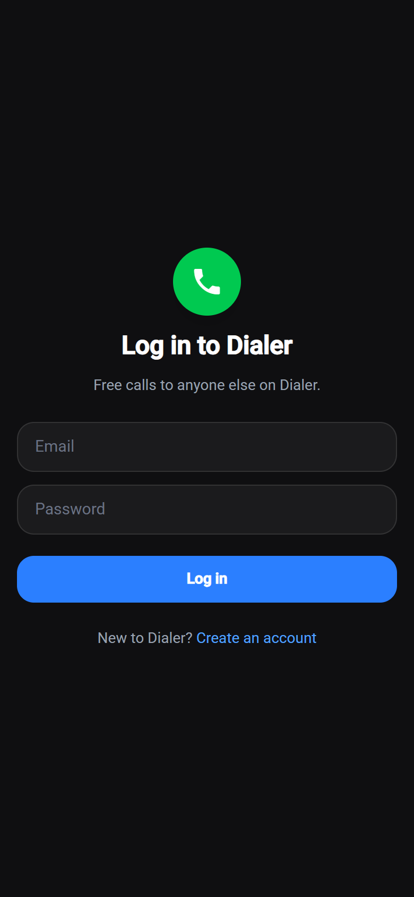 | 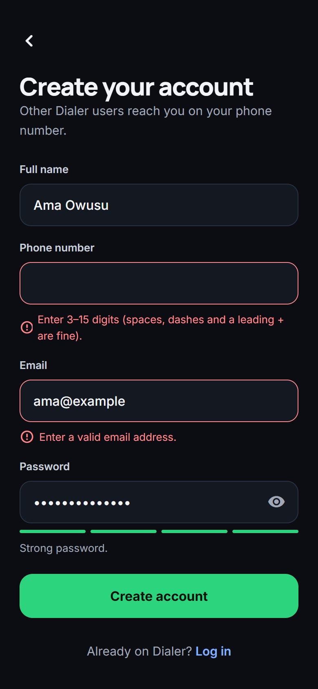 | 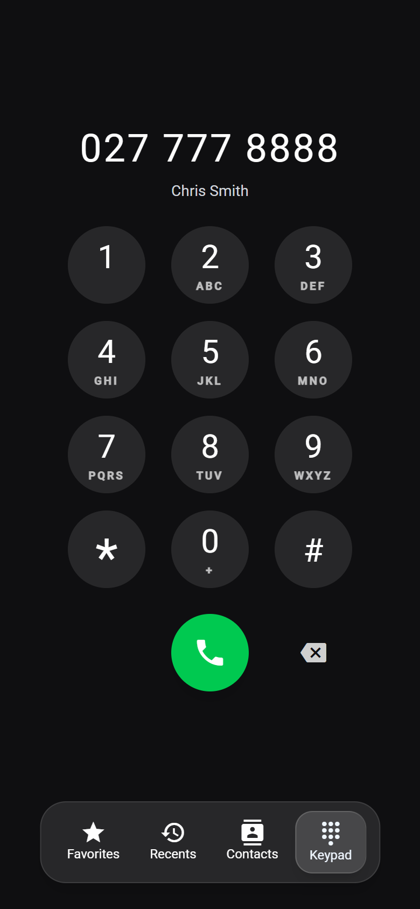 |
| **Contacts** | **Contact** | **Recents** |
| 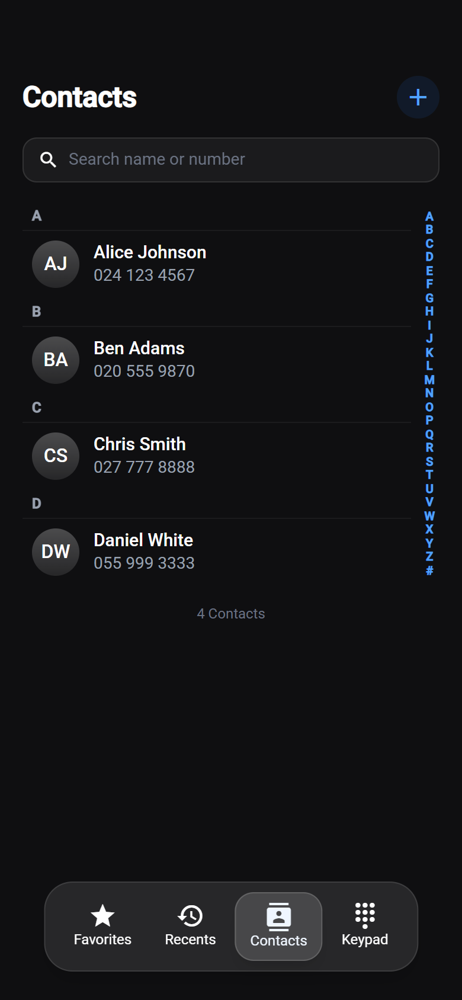 | 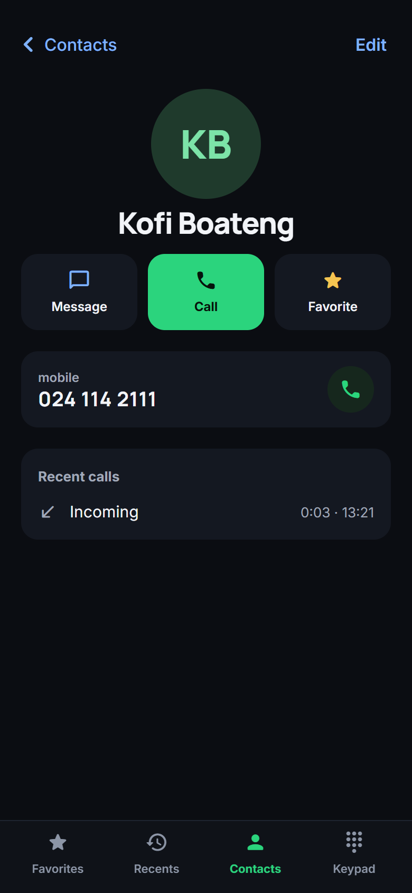 | 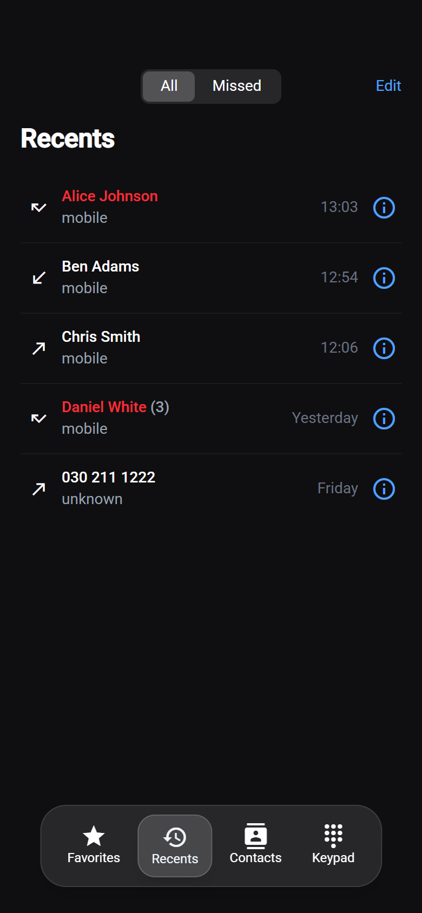 |
| **Incoming call** | **In a call** | **New contact** |
| 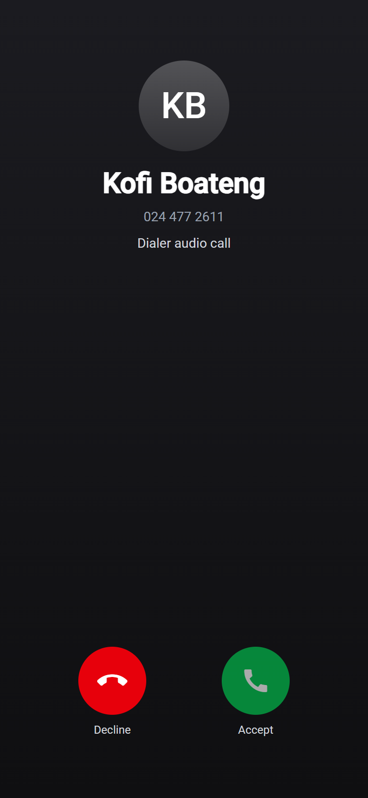 | 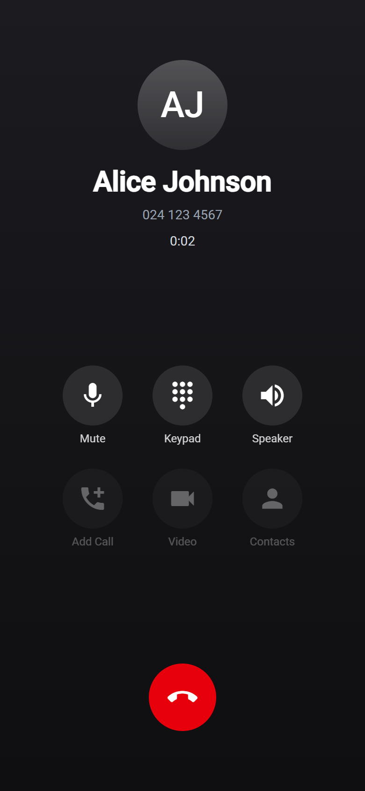 | 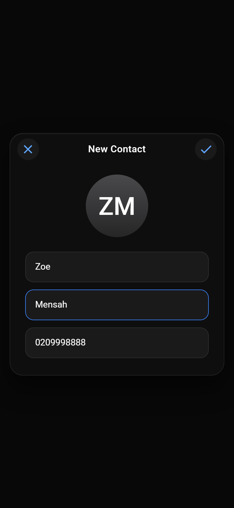 |

**Light**

| Log in | Keypad | Contacts |
| :---: | :---: | :---: |
| 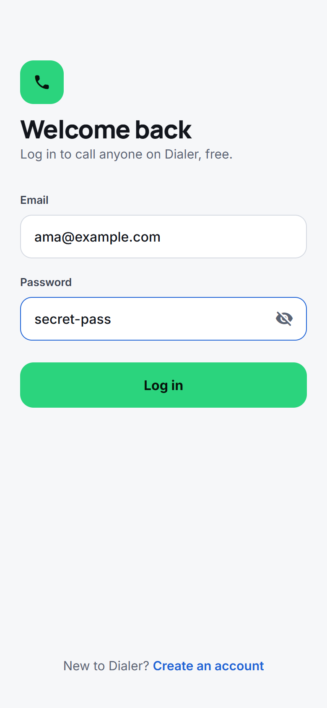 | 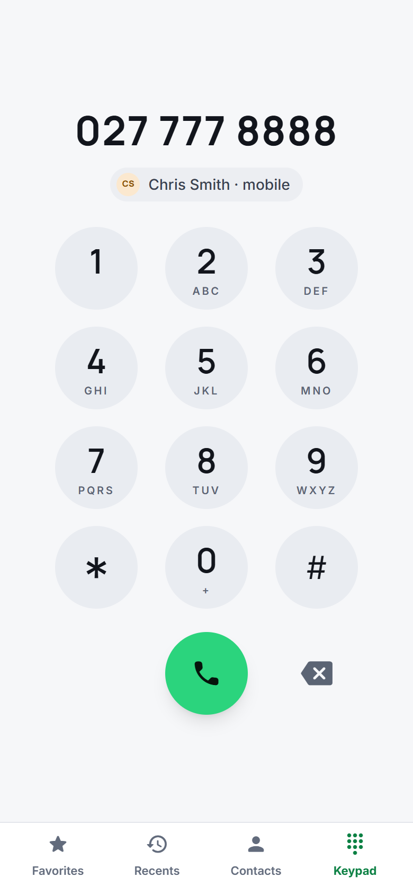 | 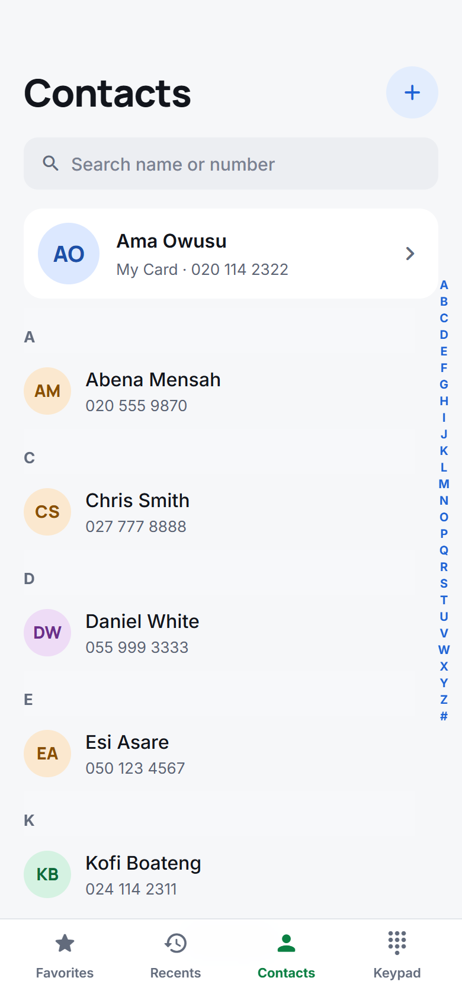 |
| **Recents** | **In a call** | **My Card** |
| 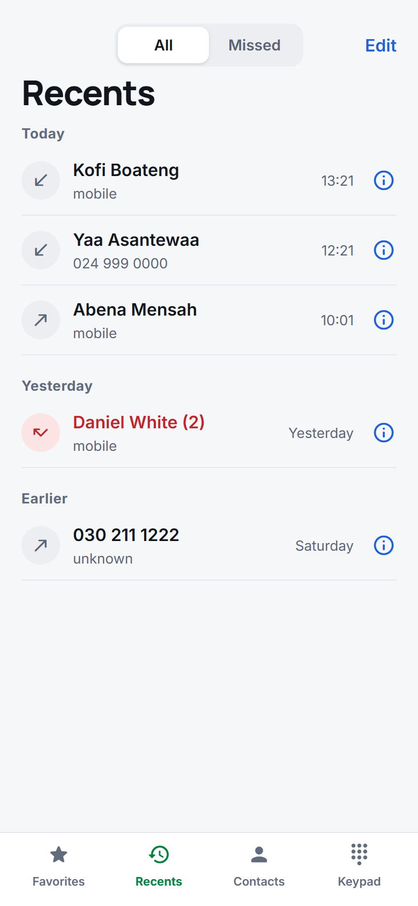 | 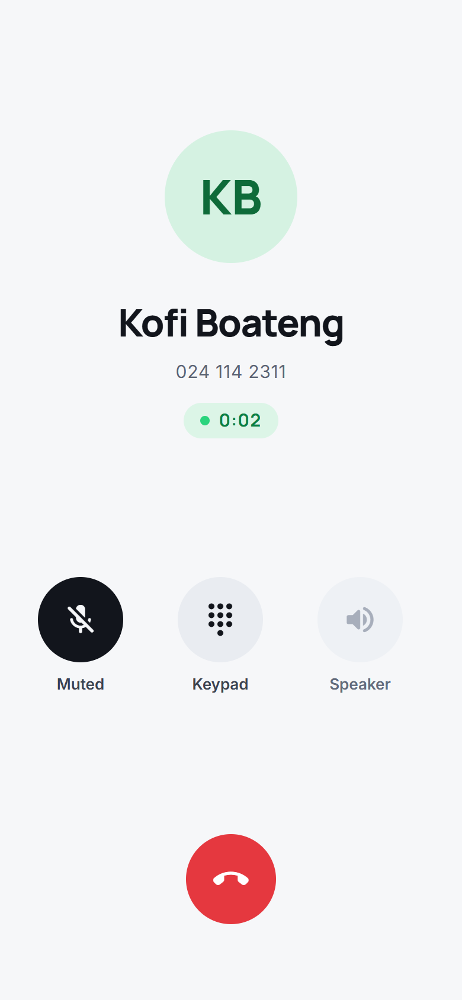 | 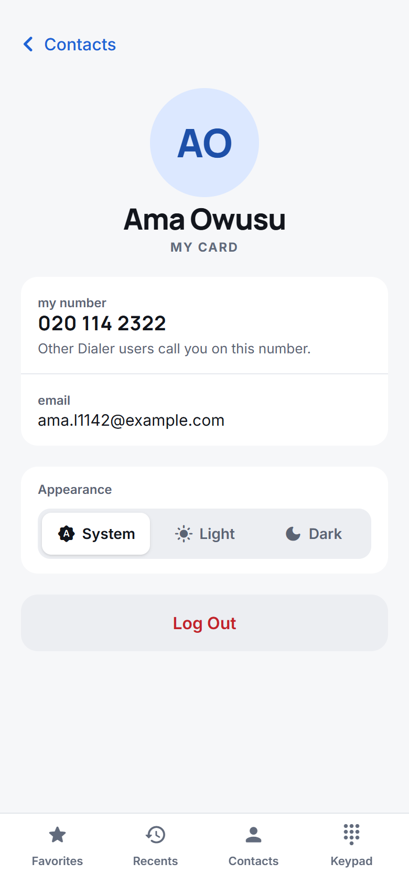 |

All screenshots are from the running app with real accounts; the calls are real browser-to-browser calls. The design was made in Claude Design first and then built.

## Features

**Accounts**
- Sign up with your name, phone number, email and password. Your phone number is how other Dialer users call you.
- Log in, stay logged in across reloads, and log out from **My Card** (top of Contacts). An expired session sends you back to the login screen.
- The eye button in a password field shows or hides what you typed. Sign-up also shows how strong your password is.
- **Appearance:** light and dark themes. Dialer follows your device until you pick System, Light or Dark on My Card.
- Your contacts and call history are stored on the server and private to your account.

**Keypad**
- Keys show their letters (2 ABC, 3 DEF…). Hold **0** to type **+**.
- Hold **backspace** to clear the whole number.
- Works with your computer keyboard too (see [Keyboard shortcuts](#keyboard-shortcuts)). Pasting a number also works.
- Numbers are formatted as you type (`024 123 4567`), and the contact's name appears when the number is saved.
- Pressing call with nothing typed fills in the last number you dialled.
- **Add Number** offers *Create New Contact* or *Add to Existing Contact*.

**Contacts**
- Alphabetical list with A–Z section headers and a letter index to jump through it.
- Search by name or phone number.
- Each contact has a detail page: call, message, add to favourites, and recent calls with that contact.
- Create, edit and delete contacts. First name and a valid phone number are required, and a number that's already saved is flagged.

**Favorites**: starred contacts. Tap a contact to call; tap ⓘ for details.

**Recents**
- Calls are listed under **Today**, **Yesterday** and **Earlier**.
- Only back-to-back calls with the same number, type and day are grouped, e.g. "Daniel White (3)".
- Incoming, outgoing and missed calls each have their own icon.
- *All / Missed* filter, an ⓘ button that opens the contact (or creates one for an unknown number), and *Edit* mode to delete rows or clear everything.

**Calls**
- Free calls to anyone else on Dialer, browser to browser. Status moves from calling to ringing to connecting to a running timer, which starts when you can actually hear each other.
- Incoming calls open the call screen with **Accept / Decline** and a ringtone, in every tab you have open. Callers hear a ringback tone.
- Phone-like outcomes: *Busy*, *No answer*, *Declined*, *Not available right now*, *Call dropped*, and *Missed call* for the person called. Missed calls show in Recents.
- Recents shows the caller's Dialer name (like caller ID) when the number isn't in your contacts.
- Dialling a number that isn't on Dialer offers **Call from your phone**, which hands the number to your device's phone app.
- **Mute** turns off your microphone, and the in-call **keypad** sends real touch tones. **Speaker** is shown but disabled, because browsers can't switch to the loudspeaker.
- If you leave the call screen during a call, a green **Return to call** banner takes you back.

## Keyboard shortcuts

On the keypad screen:

| Key | Action |
| --- | --- |
| `0`–`9`, `*`, `#`, `+` | Type the key |
| `Backspace` | Delete the last digit |
| `Escape` | Clear the number (or close the *Add Number* menu) |
| `Enter` | Call the number; with nothing typed, fill in the last number dialled |
| `Ctrl`+`V` | Paste a number (letters and other characters are dropped) |

With a mouse or touch screen: hold **0** for **+**, and hold **backspace** to clear everything.

## How calling works (for free)

Calling ordinary phone numbers through the phone network is never free. Every provider that connects to it (Twilio, Vonage, Telnyx, SIP trunks) bills per minute, and their trials only let you call numbers you've verified. So this project calls **between users of the app**, the way WhatsApp or Messenger calls work:

1. Everyone signs up with their phone number.
2. When you dial a number that belongs to another user who has the app open, the server rings them over a WebSocket (socket.io).
3. Both browsers then talk to each other directly using **WebRTC**, the calling technology built into every modern browser. The audio never passes through the server, so there's nothing to pay for.
4. Google's free public **STUN** servers help the two browsers find a route to each other. Users behind very strict firewalls may also need a **TURN** relay; you can self-host one for free with [coturn](https://github.com/coturn/coturn) and set `TURN_URL` on the server.
5. The server writes each call to both people's history: outgoing for the caller, and incoming or missed for the person called.

For a number that isn't registered in the app, the client offers to hand the call to the device's own phone app (a `tel:` link). That's free for us; the user's own phone plan applies.

To receive calls, the app has to be open in a browser tab (logged in). Calls need a secure page, which means `https` or `localhost`, because browsers only allow microphone access there.

## Current limitations

- **No phone-network calls.** Only app-to-app calls are possible for free (see above).
- **Calls only reach open tabs.** There are no push notifications, so someone who doesn't have Dialer open shows as *Not available right now* (they still get a missed call in Recents).
- **Strict firewalls** can stop the audio from connecting without a TURN relay; the call screen says so when it happens.
- **Numbers are matched by their digits**, so `024 123 4567` and `0241234567` are the same number, but `+233 24 123 4567` is not.

## Getting started

### Requirements

- **Node.js 20.19+ or 22.12+** (needed by Angular 20) and npm
- For the server, a MongoDB database. `npm run db` starts a free local one with nothing to install (see below).

Run the backend first, then the frontend.

### Run the backend

```bash
cd server
npm install
cp .env.example .env   # then set JWT_SECRET to a long random string
npm run db             # terminal 1: free local MongoDB on port 27017 (data kept in server/.mongo-data)
npm run start:dev      # terminal 2: the API, restarting on file changes
```

The API is served under **<http://localhost:3000/api>**; check it with `GET /api/health`. If port 3000 is already taken on your machine, set `PORT` in `.env` (e.g. `PORT=3300`).

Instead of `npm run db`, you can point `MONGODB_URI` at a MongoDB Community Server you installed yourself, or at a free MongoDB Atlas (M0) cluster.

See the [server README](server/README.md) for every setting, the API endpoints and the calling protocol.

### Run the frontend

```bash
cd client
npm install
npm start          # terminal 3; same as: npx ng serve
```

Open **<http://localhost:4200>** and create an account. The dev server forwards `/api` and the calls socket to the backend (see [`client/proxy.conf.js`](client/proxy.conf.js)). If the API isn't on port 3000, tell it where it is:

```bash
# PowerShell
$env:API_URL = "http://localhost:3300"; npm start
# Git Bash / macOS / Linux
API_URL=http://localhost:3300 npm start
```

The page reloads when you save a file. The layout is designed for phone width; to preview it that way, open your browser's dev tools and turn on the device toolbar (Ctrl+Shift+M in Chrome).

**To try a call**, open the app in two browser windows that don't share storage (for example a normal window and a private one, or two different browsers), create a different account in each, and dial one account's number from the other.

Other commands, run from `client/`:

| Command | What it does |
| --- | --- |
| `npm run build` | Production build into `client/dist/client/` |
| `npm test` | Unit tests with Karma (needs Chrome) |

> **Windows note:** if `ng build` or `ng serve` crashes in Git Bash with `fatal error: all goroutines are asleep - deadlock!`, run it from PowerShell or Command Prompt instead.

## Deploy for free

The app deploys as **one service**: the NestJS server serves the Angular build and the API from the same address, so there is no CORS to set up and the calls socket works without extra settings. It runs on [Render](https://render.com)'s free plan with a free [MongoDB Atlas](https://www.mongodb.com/atlas) M0 database. Neither needs a credit card.

To run the same thing on your own machine:

```bash
cd client && npm run build    # the server serves client/dist/client/browser when it exists
cd ../server && npm run build && npm run start:prod
```

Then open <http://localhost:3000>.

### 1. The database (MongoDB Atlas M0)

1. Create a free account at [mongodb.com/atlas](https://www.mongodb.com/atlas), then create a cluster and choose **M0 (Free)**. Pick a region close to your Render region.
2. Under **Database Access**, add a database user with a password. Use a generated password; symbols in a password have to be URL-encoded in the connection string.
3. Under **Network Access**, add `0.0.0.0/0` (allow from anywhere). Render's free plan has no fixed IP address to allow instead. The database user's password protects the data.
4. Under **Connect → Drivers**, copy the connection string. Add a database name after the host, e.g. `mongodb+srv://dialer:<password>@cluster0.abcde.mongodb.net/call-dialer?retryWrites=true&w=majority`.

### 2. The app (Render free web service)

1. Push this repository to GitHub (or GitLab).
2. On Render, choose **New → Blueprint** and pick the repository. Render reads [`render.yaml`](render.yaml), which builds both apps, starts the server and checks `/api/health`. It also generates `JWT_SECRET` and sets `TRUST_PROXY=1`.
3. When Render asks for the remaining values, fill them in:
   - `MONGODB_URI`: the Atlas connection string from step 1.
   - `CLIENT_ORIGIN`: the service's address, e.g. `https://dialer.onrender.com`. You'll see it on the service page once it's created; if you don't know it yet, set it afterwards under **Environment**.
   - `TURN_URL`, `TURN_USERNAME`, `TURN_CREDENTIAL`: leave these empty unless you have a TURN relay (see below).
4. The first build takes a few minutes. Then open the service's address and create an account. It's served over HTTPS, so microphone access, and with it calling, works.

### What the free plans mean

- **The service sleeps after 15 minutes without visitors.** The next visit wakes it, which takes about a minute. While it's asleep nobody is connected, so calls can't ring anyone. That's fine for a demo or a small group; a paid plan, or another host that keeps the server running, removes the delay.
- **750 free hours a month** on Render: enough for one service running all month.
- **Atlas M0** holds 512 MB, which is plenty for accounts, contacts and call history.
- **Call audio costs nothing.** It goes directly between the two browsers and never through Render (see [How calling works](#how-calling-works-for-free)).
- **TURN (optional).** Most calls connect with the free STUN servers alone. For callers behind very strict firewalls, you can run [coturn](https://github.com/coturn/coturn) on an always-free virtual machine (for example Oracle Cloud's free tier) and set the three `TURN_*` variables.

## Tests

| What | Where | Run |
| --- | --- | --- |
| **Full app, end to end**: the real client and API in Chrome, with real accounts, contacts, Recents and calls | [`e2e/`](e2e/) | `cd e2e && npm install && npm test` |
| API end to end: every endpoint and the calling protocol, against an in-memory MongoDB | `server/test/` | `cd server && npm run test:e2e` |
| Unit tests | `server/src`, `client/src` | `npm test` in `server/` or `client/` |

The full-app suite starts its own copy of the app the way it is deployed: a throwaway in-memory MongoDB, and the built server on port 3399, serving the **production build** of the client and the API together. So the tests check exactly what gets deployed. It never touches a database or dev server you are using. It drives the Chrome you have installed. Each call test uses two browser sessions with Chrome's fake microphone, and measures with WebRTC's own statistics that audio really flows both ways.

```bash
cd e2e
npm install
npm test               # all tests, about 5 minutes
npm run test:headed    # watch it in a visible browser
npm run report         # open the HTML report (screenshots and traces of any failure)
```

To test an app that is already running instead, set `E2E_BASE_URL`, e.g. `E2E_BASE_URL=http://localhost:4200 npm test`.

## Project structure

```text
client/src/app/
├── components/
│   ├── atoms/        avatar, keypad button, icon button, search input, contact row,
│   │                 notification toast, long-press directive
│   ├── molecules/    contact list, in-call controls
│   ├── organisms/    keypad grid, tab bar
│   └── pages/        login, register, account (My Card), keypad, contacts, contact detail,
│                     contact form (new + edit), favorites, recents, call
├── core/
│   ├── api/          API base path, error messages, the interceptor that sends the login token
│   ├── services/
│   │   ├── auth/         AuthService (session), login/sign-up guards
│   │   ├── contacts/     ContactService: contacts from the API
│   │   ├── calls/        CallService (WebRTC calls over the server's socket), RecentsService
│   │   │                 (call history from the API), ringtone, route guard for /call
│   │   └── notification/ toast messages
│   └── utils/        phone number formatting/validation, call times, localStorage helpers
└── app.routes.ts

server/src/
├── main.ts, app.setup.ts   startup: /api prefix, security headers, CORS, input validation
├── config/           environment variables (checked at startup), serving the client build
├── common/           phone-number rules (same as the client), MongoDB helpers
└── modules/
    ├── users/        User schema; look up a user by phone number
    ├── auth/         sign up, log in, JWT guard (every route needs a token unless marked public)
    ├── contacts/     contacts API
    ├── calls/        call-history API, STUN/TURN server list
    └── signaling/    socket.io gateway that sets up WebRTC calls between users
server/test/          API end-to-end tests against an in-memory MongoDB
e2e/                  full-app tests: client + API + MongoDB, driven in Chrome (Playwright)
render.yaml           free deployment on Render (see Deploy for free)
```

Components follow an atomic-design layout, from small to large: atoms → molecules → organisms → pages. State is held in Angular signals inside the services, and the pages only read from them. The services load the signed-in user's data from the API after login and clear it on logout.

### Routes

| Path | Page |
| --- | --- |
| `/login`, `/register` | Log in and create an account (`?returnUrl=…` comes back afterwards) |
| `/keypad` | Keypad (home) |
| `/favorites` | Favourite contacts |
| `/recents` | Call history |
| `/contacts` | Contact list (`?addNumber=…` opens it in "pick a contact" mode) |
| `/contacts/new` | New contact (`?phone=…` fills in the number) |
| `/contacts/:id` | Contact detail |
| `/contacts/:id/edit` | Edit contact |
| `/account` | My Card: your number and email, and Log Out |
| `/call` | Call in progress or ringing. Without one, it redirects to `/keypad` |

Every page except login and sign-up needs an account.

## Roadmap

1. ~~**REST API** for contacts and calls, plus authentication.~~ Done.
2. ~~**Call signalling** for free app-to-app calls.~~ Done.
3. ~~**Connect the client:** accounts, contacts and Recents from the API, and real WebRTC calls with a `tel:` fallback.~~ Done.
4. **Deploy for free**, for example the API on a free hosting tier, the database on MongoDB Atlas M0, and the client on a free static host.
